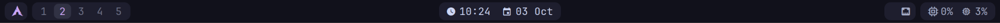
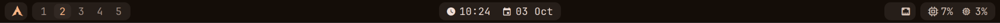

<div align="center">

# ☕ capputchin-waybar

**A minimal, compact [Catppuccin Mocha](https://catppuccin.com) Waybar for Hyprland on Arch Linux, with optional [matugen](https://github.com/InioX/matugen) wallpaper colours.**

No giant pills, no blur, no gradients. Just small dark islands, a purple accent and the info you actually look at.



<sub>Rendered at 1920×1200 @ 1.5× scaling. Media, Bluetooth, Wi-Fi and battery appear automatically when they're available.</sub>


</div>

---

## Layout

```
┌──────────────────────────────────────────────────────────────────────────────────────┐
│ [] [1 2 3 4 5]          [󰥔 12:59  󰃭 03 Oct]       [󰏤 song] [󰕾 40% 󰤨 󰂯 󰁹 80%] [ 󰍛] [tray] │
└──────────────────────────────────────────────────────────────────────────────────────┘
   left                         center                              right
```

| Section | Modules | Interaction |
|---|---|---|
| **Left** | Arch logo · `hyprland/workspaces` | Click a workspace to switch to it. Active = mauve, empty = dimmed |
| **Center** | `clock` (time + date) | Hover shows the calendar, scroll changes the month, click opens `gnome-calendar` if installed |
| **Right** | `mpris` | Left click = play/pause · middle = previous · right = next. Hidden when nothing is playing |
| | `pulseaudio` | Scroll = ±5% · click = mixer (`pavucontrol` / `pwvucontrol`) · middle = mute (`wpctl` / `pactl`) |
| | `network` | Icon shows Wi-Fi signal / ethernet / disconnected · click = `nm-connection-editor`, `iwgtk` or `nmtui` |
| | `bluetooth` | Click = `blueman-manager` / `overskride` / `blueberry`. Hidden when there's no controller |
| | `battery` | Percentage + charging/plugged state, peach < 25%, red < 10%. Hidden on desktops |
| | `cpu` · `memory` | Small usage indicators |
| | `tray` | Normal system tray |

Everything uses **Waybar's built-in modules**. There are **no custom scripts** and no polling shell loops.

---

## Install

```bash
git clone https://github.com/davidovicbtw/capputchin-waybar-.git
cd capputchin-waybar-
./install.sh --dry-run   # inspect only: shows what it detected and the config it would write
./install.sh             # back up, install, validate, restart waybar
```

Options: `--dry-run` (writes nothing), `--no-restart` (installs, doesn't touch the running bar), `--no-matugen` (skip the matugen wiring even if matugen is installed).

### Requirements

| Package | Needed for | Required? |
|---|---|---|
| `waybar` | everything | **yes** |
| `ttf-jetbrains-mono-nerd` (or any Nerd Font) | icons | **yes** |
| `playerctl` | `mpris` media module | optional |
| `pavucontrol` / `pwvucontrol` | volume click | optional |
| `networkmanager` (`nm-connection-editor`) | network click | optional |
| `bluez` + `blueman` | bluetooth module/click | optional |
| `matugen` | wallpaper-based colours | optional |

```bash
sudo pacman -S --needed waybar ttf-jetbrains-mono-nerd playerctl pavucontrol
```

The installer **never installs packages** and never uses `sudo`. If something is missing, it adapts the config and tells you.

---

## 🎨 Wallpaper colours with matugen



<sub>Same bar, with colours generated by matugen from a wallpaper with an orange sun on green.</sub>

The colours live in a separate **`colors.css`** that `style.css` imports. Out of the box it's Catppuccin Mocha. If matugen is installed, `install.sh` wires it up so matugen rewrites `colors.css` from your wallpaper. It uses the same colour names, so `style.css` never changes:

```
wallpaper ──▶ matugen ──▶ ~/.config/waybar/colors.css ──▶ waybar reloads (SIGUSR2)
                 ▲
                 └── ~/.config/matugen/templates/capputchin-waybar.css
```

What the installer adds to `~/.config/matugen` (nothing is removed, and `config.toml` is backed up first):

```toml
# added by capputchin-waybar install.sh
[templates.capputchin-waybar]
input_path = "/home/you/.config/matugen/templates/capputchin-waybar.css"
output_path = "/home/you/.config/waybar/colors.css"
post_hook = "pkill -SIGUSR2 -x waybar || true"
```

If `config.toml` doesn't exist yet, it's created with an empty `[config]` table plus that block. Your other templates are left alone. Running the installer again won't add the block twice, and it keeps a `colors.css` that matugen already generated.

**Apply your wallpaper:**

```bash
matugen image ~/Pictures/wallpaper.png --prefer saturation
```

`--prefer` is required in matugen 4.x when a wallpaper has several candidate colours, otherwise it asks interactively. Other choices: `darkness`, `lightness`, `less-saturation`, `value`.

**How the Material You roles map to the bar:**

| Bar variable | Catppuccin default | matugen role (always the **dark** scheme) |
|---|---|---|
| `crust` (bar background) | `#11111b` | `surface_container_lowest` |
| `base` (islands) | `#1e1e2e` | `surface_container` |
| `surface0` (active workspace bg) | `#313244` | `surface_container_high` |
| `text` / `subtext0` | `#cdd6f4` / `#a6adc8` | `on_surface` / `on_surface_variant` |
| `overlay0` (dimmed) | `#6c7086` | `outline` |
| `mauve` (accent) | `#cba6f7` | `primary` |
| `blue` (bluetooth connected) | `#89b4fa` | `tertiary` |
| `red` (critical/urgent) | `#f38ba8` | `error` |
| `green` / `peach` / `yellow` | Catppuccin | stay Catppuccin, so charging and low-battery states are always readable |

The template always uses the **dark** scheme (`colors.<role>.dark.hex`), so the bar stays dark even if you run matugen with `-m light` for the rest of your desktop.

**Going back to Mocha:** `cp waybar/colors.css ~/.config/waybar/colors.css`. Also remove the `[templates.capputchin-waybar]` block from `~/.config/matugen/config.toml`, or matugen will overwrite it again next time.

**Using DMS (DankMaterialShell)?** DMS can run matugen itself when you change wallpaper. Whether it also runs the templates in your own `~/.config/matugen/config.toml` depends on your DMS version and settings. Check its theming settings for a user-template option. If it doesn't run them, call `matugen image …` yourself after changing wallpaper.

---

## What `install.sh` does

The script makes no assumptions about your system. It checks everything first:

1. **Waybar:** stops if `waybar` isn't installed.
2. **Hyprland:** checks `hyprctl` and whether you're inside a Hyprland session, and reports any `exec-once = waybar` lines in `~/.config/hypr` (read-only). It also warns if DMS/quickshell is referenced, because that bar would run next to Waybar.
3. **Tools:** checks which of `pavucontrol`, `pwvucontrol`, `wpctl`, `pactl`, `nm-connection-editor`, `iwgtk`, `nmtui`, `blueman-manager`, `overskride`, `blueberry`, `gnome-calendar`, `playerctl`, `bluetoothctl`, `nmcli` and a terminal actually exist.
4. **Adapts the config:** each click action uses the first tool found. If none is found, that `on-click` line is removed, so nothing ever calls a missing binary.
5. **Validates** the generated config as JSON (`python3` or `jq`) **before** writing anything.
6. **Backs up** the whole `~/.config/waybar` to `~/.config/waybar.bak-YYYYmmdd-HHMMSS`. It lists your old files and the modules your old config used, so you can re-add anything you miss.
7. **Installs** only `config.jsonc`, `style.css` and `colors.css`. Other files (scripts, themes) are left alone. An existing capputchin `colors.css` (e.g. one generated by matugen) is kept. A legacy `config` file is renamed to `config.pre-capputchin`, because Waybar would otherwise load it instead of `config.jsonc`.
8. **matugen (if installed):** installs the template, backs up `config.toml` and appends one `[templates.capputchin-waybar]` block if it isn't already there.
9. **Restarts Waybar safely:** it stops the running instance, starts a detached new one, then checks that it's alive and that its log has no errors. If Waybar fails to start, the script prints the exact command to restore your backup.

It **never** edits Hyprland or DMS configuration, never uses `sudo`, and never deletes files.

### Autostart

If the installer says no `exec-once` line was found, add this to your `~/.config/hypr/hyprland.conf` yourself:

```ini
exec-once = waybar
```

### Restore / uninstall

```bash
mv ~/.config/waybar ~/.config/waybar.capputchin
mv ~/.config/waybar.bak-YYYYmmdd-HHMMSS ~/.config/waybar
pkill -x waybar; hyprctl dispatch exec waybar
```

---

## Design notes

- **Palette:** Catppuccin Mocha by default (or your wallpaper via matugen, see above). The bar is `crust` `#11111b`, islands are `base` `#1e1e2e`, text is `text`/`subtext0`, and the accent is `mauve` `#cba6f7`.
- **Size:** 30 px logical height (45 px physical at 1.5×), 13 px font, 8 px island radius, 3 px gaps. It fits 1280 px of logical width without crowding.
- **No** blur, transparency, gradients, shadows or borders (only a 1 px border on tooltips).
- **Workspaces:** 5 persistent workspaces so the layout doesn't jump. Remove `"persistent-workspaces"` in `config.jsonc` to show only the ones in use.
- `reload_style_on_change` is on, so CSS edits apply live.

## Customize

| Want to… | Edit |
|---|---|
| Change the accent | `@define-color mauve` in `colors.css` (try `blue #89b4fa` or `pink #f5c2e7`) |
| Different matugen look | `matugen image … -t scheme-vibrant` (or `scheme-expressive`, `scheme-fidelity`, …) |
| Show the Wi-Fi name | `"format-wifi": "{icon} {essid}"` in `config.jsonc` |
| Hide CPU/RAM | remove `"group/system"` from `modules-right` |
| 12-hour clock | `"format": "󰥔 {:%I:%M %p  󰃭 %d %b}"` |
| Use a different font | `font-family` at the top of `style.css` |

## Files

```
.
├── install.sh            # safe detecting installer
├── waybar/
│   ├── config.jsonc      # → ~/.config/waybar/config.jsonc
│   ├── style.css         # → ~/.config/waybar/style.css   (layout, imports colors.css)
│   └── colors.css        # → ~/.config/waybar/colors.css  (Catppuccin Mocha default)
├── matugen/
│   └── capputchin-waybar.css   # → ~/.config/matugen/templates/ (wallpaper → colors.css)
└── docs/
    ├── preview.png
    └── preview-matugen.png
```

## How it was tested

- `config.jsonc` validated as JSON; `install.sh` passes `bash -n` and `shellcheck` (only info-level notes left).
- The installer was run end to end in a sandboxed `$HOME` with stub commands, which exercised the backup, the legacy-`config` rename, tool fallbacks and click-action removal.
- The matugen integration was tested with **matugen 4.2.0**: the installer appended the block next to an existing user template, which kept working; `matugen image` generated `colors.css`; a second install didn't duplicate anything and kept the generated colours.
- The bar was rendered with real Waybar on a headless 1920×1200 @ 1.5× Wayland output to check CSS parsing, bar height and the clock format. It used `sway/workspaces` in place of `hyprland/workspaces` there, since the container has no Hyprland. Those screenshots are the previews above.

---

<div align="center"><sub>Palette by <a href="https://github.com/catppuccin/catppuccin">Catppuccin</a> · icons by <a href="https://www.nerdfonts.com">Nerd Fonts</a></sub></div>
